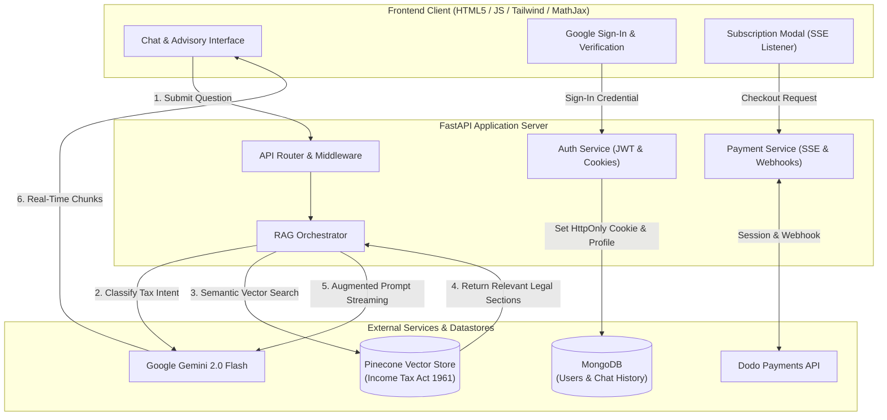

# TaxAssist - AI Indian Tax Consultant

[](https://www.python.org/)
[](https://fastapi.tiangolo.com/)
[](https://aistudio.google.com/)
[](https://www.pinecone.io/)
[](https://www.mongodb.com/)
[](https://test.dodopayments.com/)
[](https://opensource.org/licenses/MIT)

**TaxAssist** is a full-stack, enterprise-grade AI consultant designed to answer complex Indian Income Tax inquiries with high legal fidelity. Powered by **Retrieval-Augmented Generation (RAG)** over the **Income Tax Act 1961**, it combines vector semantic search (Pinecone), intent classification, LLM streaming (Google Gemini), secure session authentication, and subscription billing (Dodo Payments).

---

## Architecture Overview



---

## Key Highlights

- **Intelligent RAG Pipeline**: Uses Gemini function-calling schemas to classify inquiries. Only tax-related queries trigger vector search across the Income Tax Act 1961 index to conserve latency and token cost.
- **Token-by-Token Streaming**: Delivers fast, low-latency streaming responses using Server-Sent Events (SSE) and native streaming readers with live Markdown and LaTeX formula rendering (MathJax).
- **Stateless & Secure Authentication**: Google OAuth 2.0 ID token verification paired with HMAC-SHA256 signed `HttpOnly` session cookies to protect against XSS and session tampering.
- **Integrated Monetization**: Complete subscription lifecycle powered by Dodo Payments, including payment initiation, SSE-driven status resolution, and subscription gating.
- **Production-Grade Codebase**: Structured into modular layers (`config`, `auth`, `services`, `database`, `models`), fully typed with Pydantic, zero hardcoded credentials, and graceful offline fallbacks for local review.

---

## Repository Structure

```text
AI-Tax-Consultant/
├── backend/
│   ├── __init__.py
│   ├── config.py             # Pydantic settings & environment configuration
│   ├── database.py           # MongoDB connection pool & collection managers
│   ├── auth.py               # Google OAuth, JWT tokens, and cookie validation
│   ├── models.py             # Request & response Pydantic schemas
│   ├── main.py               # FastAPI application, routes, & static file serving
│   └── services/
│       ├── __init__.py
│       ├── vector_store.py   # Pinecone semantic search client
│       ├── llm.py            # Gemini RAG orchestration & streaming generator
│       └── payment.py        # DodoPayments checkout session & SSE resolver
├── frontend/
│   ├── index.html            # Session router & status gateway
│   ├── auth.html             # Google Sign-in & mobile OTP verification UI
│   ├── main.html             # AI advisory chat workspace with Markdown & MathJax
│   └── payment.html          # Subscription checkout & SSE payment listener
├── .env.example              # Documented environment variables template
├── .gitignore                # Git ignore rules for Python, keys, & temporary files
├── Caddyfile                 # Optional Caddy local reverse proxy configuration
├── main.py                   # Root application runner (uvicorn launcher)
├── requirements.txt          # Clean Python dependency manifest
└── README.md                 # Project documentation
```

---

## Getting Started

### 1. Prerequisites

- **Python 3.10+**
- (Optional) **MongoDB** instance running locally on `localhost:27017` (the backend runs with graceful in-memory fallbacks if MongoDB is not active).
- API Keys:
  - [Google AI Studio API Key](https://aistudio.google.com/) (for Gemini)
  - [Pinecone API Key & Index](https://app.pinecone.io/) (for Income Tax Act semantic search)
  - [Google Cloud Console Client ID](https://console.cloud.google.com/) (for Google Sign-In)
  - [Dodo Payments API Key](https://test.dodopayments.com/) (for subscription checkout)

### 2. Installation

1. **Clone the repository:**
   ```bash
   git clone https://github.com/anshuman0123/AI-Tax-Consultant.git
   cd AI-Tax-Consultant
   ```

2. **Create and activate a virtual environment:**
   ```bash
   python -m venv venv
   # On Windows:
   .\venv\Scripts\activate
   # On macOS/Linux:
   source venv/bin/activate
   ```

3. **Install dependencies:**
   ```bash
   pip install -r requirements.txt
   ```

### 3. Environment Configuration

Copy the `.env.example` file to `.env`:
```bash
cp .env.example .env
```

Open `.env` and configure your credentials:
```env
# Google Gemini
GEMINI_API_KEY=your_gemini_api_key_here
GEMINI_MODEL=gemini-2.0-flash

# Pinecone
PINECONE_API_KEY=your_pinecone_api_key_here
PINECONE_INDEX_HOST=your-index-host.svc.pinecone.io
PINECONE_NAMESPACE=income_tax_act_1961

# Authentication
GOOGLE_CLIENT_ID=your_google_oauth_client_id.apps.googleusercontent.com
JWT_SECRET_KEY=your_secure_random_jwt_secret_key_here

# Dodo Payments
DODO_PAYMENTS_API_KEY=your_dodo_payments_api_key_here
DODO_PRODUCT_ID=your_product_id_here
```

### 4. Running the Application

Start the FastAPI server:
```bash
python main.py
```
*Or using Uvicorn directly:*
```bash
uvicorn main:app --reload --host 0.0.0.0 --port 8001
```

Once started:
- Open your browser at **`http://localhost:8001`**
- Interactive API documentation (Swagger UI) is available at **`http://localhost:8001/docs`**

---

## API Reference

| Method | Endpoint | Auth Required | Description |
|---|---|---|---|
| `GET` | `/api/status` | Optional | Returns user authentication & subscription state (`not logged in`, `not subscribed`, `subscribed`). |
| `POST` | `/api/login` | No | Validates Google OAuth credential, upserts user profile, and sets HttpOnly JWT session cookie. |
| `POST` | `/api/logout` | No | Clears user session cookie. |
| `POST` / `GET` | `/api/answer` | **Yes** | Evaluates tax query, retrieves Pinecone legal context, and streams Gemini response. |
| `POST` | `/api/new_chat` | **Yes** | Resets active conversation context for the authenticated user. |
| `GET` | `/api/create_payment` | **Yes** | Initiates Dodo Payments session and streams SSE status events (`payment init`, `payment result`). |
| `GET` | `/api/payment_status` | No | Callback endpoint that confirms payment status and updates subscription records. |

---

## Security & Best Practices

- **Zero Hardcoded Secrets**: All keys, secrets, database hosts, and tokens are strictly configured through environment variables.
- **HttpOnly Cookies**: Session tokens are transmitted via `HttpOnly` and `SameSite` cookies, mitigating cross-site scripting (XSS) risks.
- **Input Validation**: Incoming requests are validated against strict Pydantic schemas.
- **Safe Fallbacks**: The server degrades gracefully during local development or offline evaluations when third-party cloud services are unreachable.

---

## License

This project is licensed under the [MIT License](LICENSE).
